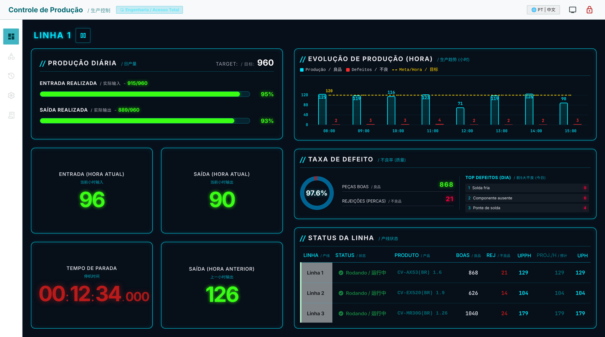
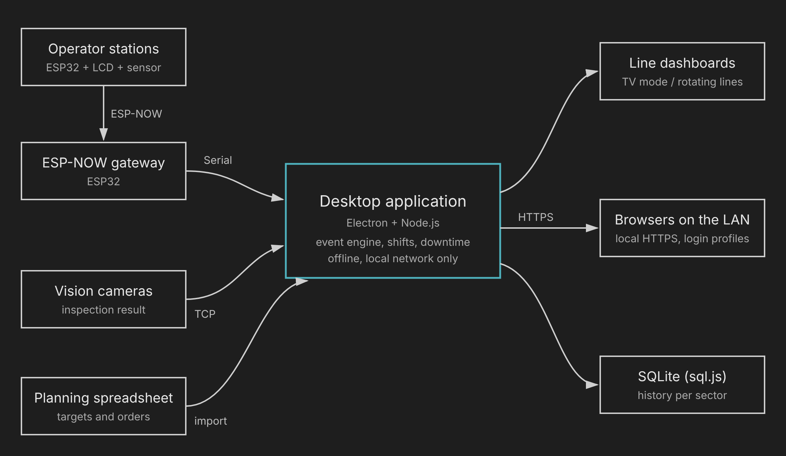
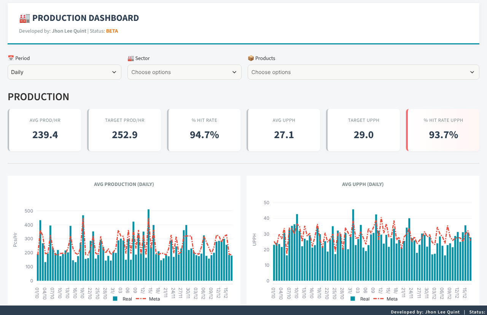

# Hourly Production Monitoring System

Real-time production monitoring for electronics assembly lines: ESP32 operator stations on the line, a desktop application that turns line events into hourly indicators, and dashboards for the shop floor and management.

Current desktop application (Nov 2026), shown with fictional data. The interface is bilingual (Portuguese / Chinese) for the plant teams.

## The problem

Hourly output, efficiency (UPPH) and defects were tracked in spreadsheets filled in by hand. Numbers arrived late, depended on manual entry and gave no view of downtime while it was happening.

## What I built

- **Operator stations (ESP32).** Count parts with an ultrasonic sensor, register solder and component defects with dedicated buttons, and send each event over ESP-NOW to a gateway connected to the desktop application.
- **Desktop application (Electron + Node.js).** Reads events from serial (ESP32 gateway) and TCP (vision cameras), calculates hourly output, UPPH, quality rate and downtime per shift, and serves the dashboards over HTTPS on the local network. Runs fully offline.
- **Dashboard prototype (Python + Streamlit).** The first version of the project, reading spreadsheets, kept here as the starting point.

## Architecture

## Evolution

| Jan 2026 - first prototype | Nov 2026 - current version |
|---|---|
|  |  |
| Python + Streamlit, spreadsheet filled in by hand | Electron + Node.js, real-time data from the line |

## Repository layout

| Folder | Content | Source |
|---|---|---|
| [`firmware/`](firmware) | Arduino and ESP32 prototypes (C++) | Full, with simulator links |
| [`dashboard/`](dashboard) | Dashboard prototype (Python, Streamlit) | Full, synthetic data |
| [`desktop-app/`](desktop-app) | Desktop application case study | Architecture, decisions and examples |

## Tech stack

- **Embedded:** C++, Arduino, ESP32, FreeRTOS, ESP-NOW, Tinkercad, Wokwi
- **Desktop:** JavaScript, Node.js, Electron, serialport, SQLite (sql.js), HTTPS
- **Data:** Python, Streamlit, pandas, Plotly

## Timeline

From the first Arduino prototype (Dec 2025) to the current desktop release (Nov 2026): see [CHANGELOG.md](CHANGELOG.md).

## About the source code

The desktop application runs in production, so its source code is kept private; [`desktop-app/`](desktop-app) documents its architecture and evolution instead. Product names, sector codes and data in this repository are fictional.

---

Jhon Lee Quint
