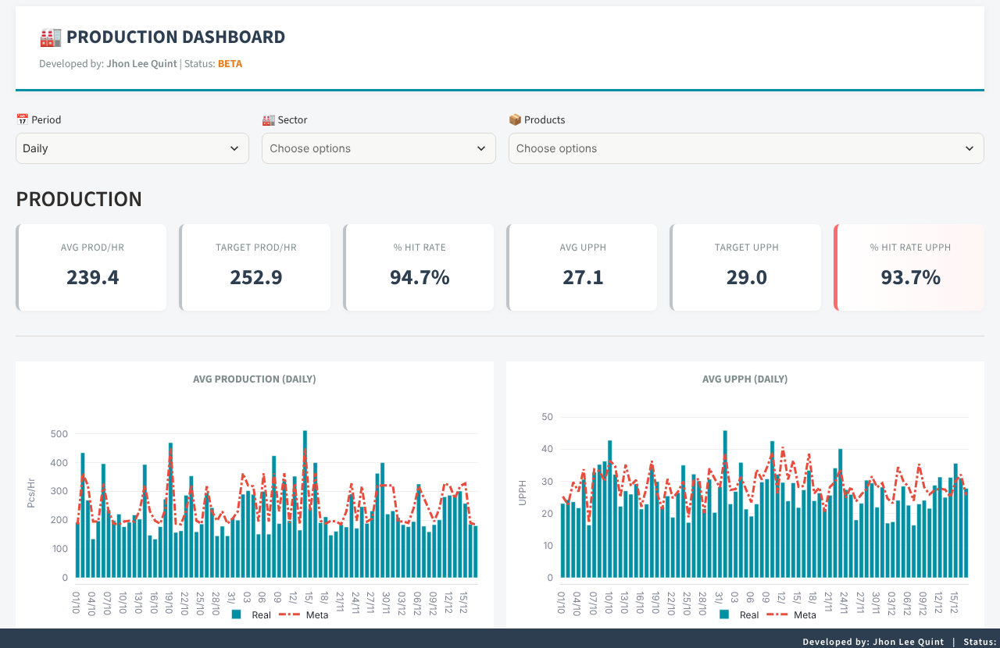

# Dashboard prototype

First version of the project: a Streamlit dashboard for industrial KPIs (production, quality and HR) read from a spreadsheet, with sector filter and interface in Portuguese, English and Traditional Chinese.



> `data/production_data.xlsx` holds synthetic data generated by `scripts/generate_sample_data.py`. Product names and sectors are fictional.

## Structure

- `app.py` - Streamlit application.
- `charts.py` - Plotly charts.
- `data_processor.py` - loading, filtering and aggregation.
- `assets/` - CSS.
- `data/` - sample dataset.
- `scripts/` - sample data generator.

## Run

```bash
pip install -r requirements.txt
streamlit run app.py
```

Python 3.8+.
