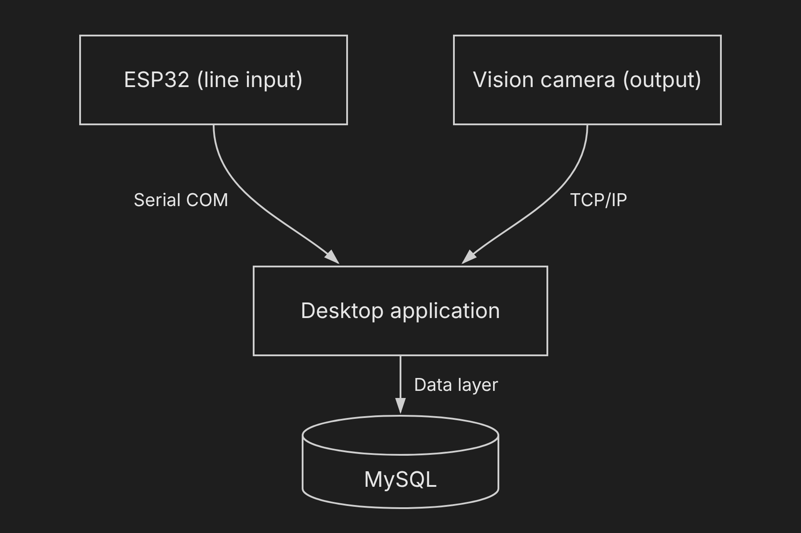
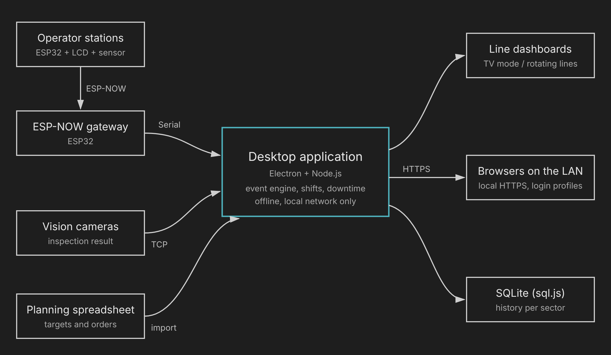
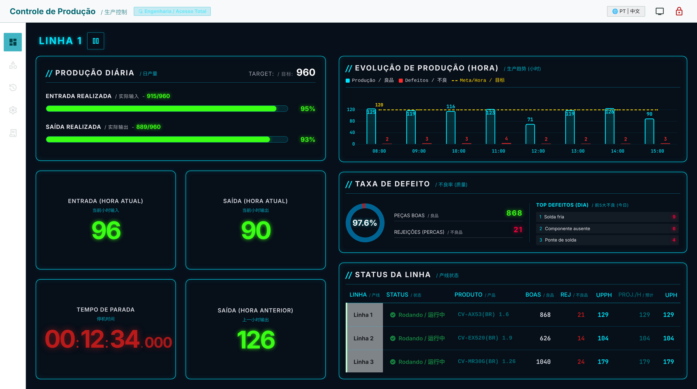

# Desktop application (case study)

The desktop application is the core of the system. It runs on a PC next to the line, collects events from the line devices and keeps the production indicators up to date. It works fully offline inside the plant network.

> The source code is private because the application runs in production. This document covers the architecture, the technical decisions and how the application evolved. The `examples/` folder holds small, self-contained snippets written to illustrate those decisions; they are not extracted from the application.

## Requirements (Mar 2026)

- No internet on the shop floor: everything has to run on a closed local network.
- Read inspection results from industrial vision cameras over TCP.
- Run unattended on line PCs and TV panels.
- Never lose counted production after a power cut.

## Architecture decision (Apr 2026)

The Streamlit prototype depended on a Python environment and on spreadsheets filled in by hand. The next step is a self-contained desktop executable: one installer per line PC, all dependencies bundled, devices read directly.

A JavaFX proof of concept was tried first and dropped the same day because of runtime issues on the factory PCs. Electron with Node.js was chosen instead: a single installer, a web interface, and native access to serial ports and sockets.

## Evolution

### 1.0.0 (Jun 2026)

- Electron + Node.js desktop application with an offline web interface.
- Line data received from a direct TCP client in JSON.

### 1.1.0 (Jun 2026)

- JSON replaced by newline-delimited raw text over a standard TCP socket, which is what the cameras send natively. A single read can carry half a line or several lines, so input is buffered until each newline. See [`examples/tcp-line-reader.js`](examples/tcp-line-reader.js).

### 2.0.0 (Jul 2026)

- Several lines monitored at the same time, with data fully isolated per line.
- Line-stopped detection that respects shift schedules. Input and output each have their own idle timer (20 s) and one never resets the other, so a jam where the input stops while the output keeps draining is still counted. See [`examples/downtime-timer.js`](examples/downtime-timer.js).
- Full-screen TV mode rotating between lines.
- Interface in Portuguese, English and Mandarin.

### Line integration prototype (Aug 2026)

ESP32 at the line input over serial, vision camera at the output over TCP, both read independently so a failure on one side never blocks the other. The firmware for the input side is in [`../firmware`](../firmware).

### 2.5.0 (Aug 2026)

- Fonts bundled as local WOFF2 files; the interface never depends on a CDN.
- Small local TCP bridge utilities for tests and network setup.

### 2.8.0 (Sep 2026)

- Camera connection guide written for the maintenance team.
- 1 Hz heartbeat to detect disconnected devices.
- Daily storage in JSON files, one per day, written with an atomic rename so a power cut cannot corrupt them.

### 3.0.0 (Oct 2026)

- Serial (COM) input from the ESP32 gateway with the line protocol `MODEL|EVENT|CATEGORY|QTY`; lines that do not match (gateway debug output, noise) are discarded. See [`examples/serial-event-parser.js`](examples/serial-event-parser.js).
- Access control with password profiles (administrator and viewer).
- User manual for operators.

### Packaging systems analysis (Nov 2026)

- Configuration of the packaging and warehouse systems studied to plan a single source for production orders and serial numbers.

### 3.1.0 - 3.2.1 (Nov 2026)

- Remote access served by a local HTTPS server (port 3000) instead of an external tunnel; legacy TCP and serial drivers archived.
- Persistence moved to SQLite running in WebAssembly (sql.js); events classified automatically per station.
- Targets and production orders read from the planning spreadsheet and exposed through a protected API route.
- Station pairing, shift and planned-stop management, history per sector and production installers.

### 3.2.1 pairing adjustments (Nov 2026)

- TLS certificates stabilized, one access key per physical station, legacy manual registration removed from the interface.

## Current interface

Line view with fictional data: daily input/output against target, hourly production chart, defect rate with top defects, downtime timer and the status of every line.

## Security practices

- No passwords or keys in the source code: initial credentials are generated on first run and stored only as hashes.
- API keys are encrypted with the operating system credential store (Electron `safeStorage`).
- Remote access only inside the plant network, over HTTPS, with per-station keys.

## Stack

JavaScript (Node.js, Electron), HTML, Tailwind CSS, Chart.js, `serialport`, `net`, SQLite via sql.js.
