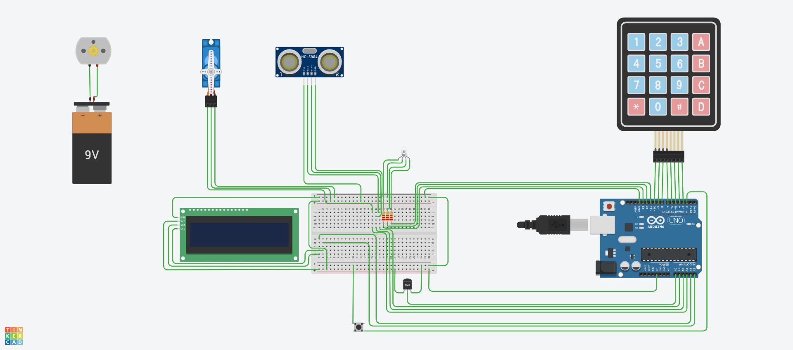
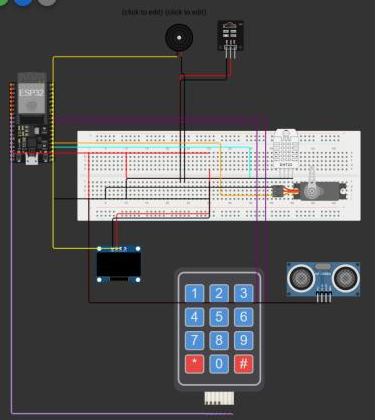
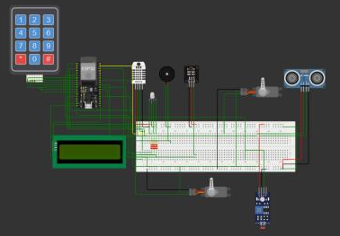
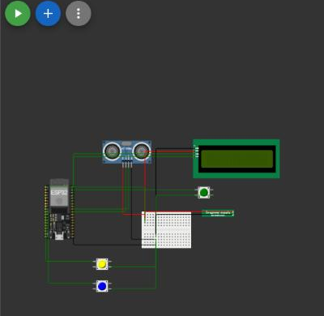

# Firmware

Operator station prototypes, from a first Arduino build to the ESP32 version that talks to the desktop application.

## V1 - Arduino Uno (Tinkercad)



- 4x4 keypad login and LCD menu (production, setup, stops).
- Production pulses counted through an interrupt.
- Ultrasonic part detection and servo reject.
- TMP36 temperature alarm and RGB andon light.
- Automatic lock after 8 h, 2 min menu timeout and lock after end of shift.

Simulation: [Tinkercad](https://www.tinkercad.com/things/6rfiOlwrk9n-sistema-automatizado-de-inspecao-e-monitoramento-v1)

## V2 - ESP32 (Wokwi)



- Moved to ESP32 with three FreeRTOS tasks: interface, logic and sensors.
- OLED display, DHT22 temperature/humidity, IR pulse input for production count.
- Servo sorting by distance and andon light with idle alarm.
- Buzzer and servo share a hardware timer, so the sensors task calls `noTone()` before moving the servo.

Simulation: [Wokwi](https://wokwi.com/projects/451920072909436929)

## V3[A] - ESP32 (Wokwi)



- Two reject servos (color and distance) with non-blocking cycles.
- TCS3200 color sensor (digital stand-in when `SIMULACAO` is true), TCRT5000 IR counter.
- Environmental alarm (temperature/humidity) that can be silenced for 5 minutes.

Simulation: [Wokwi](https://wokwi.com/projects/452354648559407105)

## V3[B] - ESP32 operator station + gateway (ESP-NOW)



The station counts parts and registers defects; each event goes over ESP-NOW to a gateway ESP32 plugged into the PC running the desktop application.

Operation:
- Short press on MODE cycles through the product models; hold for 4 s to confirm.
- The ultrasonic sensor counts a part when something passes within 10 cm.
- SOLDER and COMPONENT buttons register a defect of that category.
- Three quick presses on MODE return to the model menu.

### Protocol

The station sends a fixed-size struct:

```c
typedef struct {
  char model[32];
  char event[32];     // PRODUCTION | DEFECT | MODEL_SELECTED
  char category[32];  // SOLDER | COMPONENT (defects only)
  uint32_t quantity;
} Message;
```

The gateway prints a debug block and then one line per event for the desktop application:

```
CV-AX53(BR)1.6|DEFECT|SOLDER|1
```

Before flashing the station, set `gatewayMAC` in `operator-station.ino` to the MAC address the gateway prints at boot.
